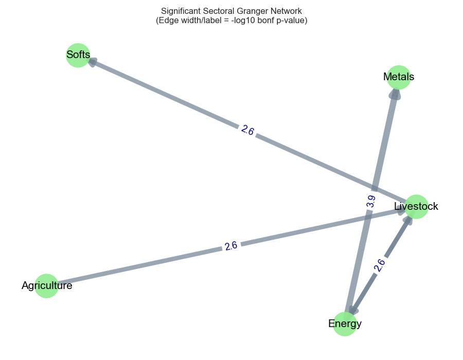
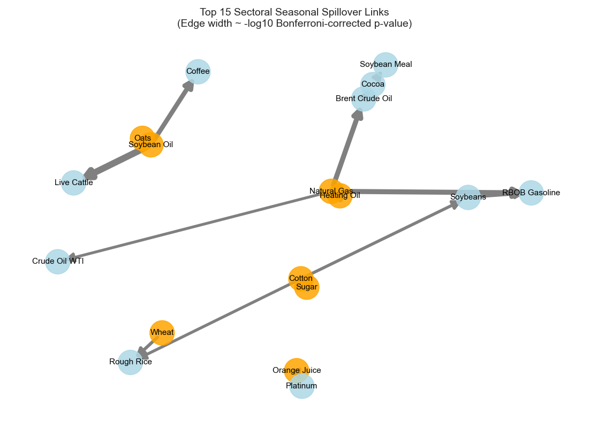

# Do Seasonal Effects Spill Over Across Commodity Markets?

Code, data, and results for the paper *"Do Seasonal Effects Spill Over Across Commodity Markets?"* (Ujjwal Sharma, NMIMS Mumbai).

Seasonality is a well-known driver of individual commodity prices: grains move with planting and harvest cycles, natural gas with winter heating demand. This project asks a less-studied question: **does the seasonal component of one commodity market predict the seasonal component of another?** If it does, seasonal risk can travel between markets, which matters for hedging, portfolio construction, and policy.

## Data

- 24 commodity futures across five sectors (agriculture, energy, metals, softs, livestock), downloaded with `yfinance`
- Daily closing prices from 2010-01-04 to 2024-12-31
- Analysis runs on daily log-returns; all series pass the ADF stationarity test (KPSS agrees for all except cocoa)

## Method

1. **STL decomposition** of each return series into trend, seasonal, and residual components, with an annual period of 252 trading days. Seasonal strength is measured as `F_S = max(0, 1 - Var(R) / Var(S + R))` (Hyndman & Athanasopoulos, 2018).
2. **Pairwise Granger causality** on the seasonal components for all 552 directed commodity pairs, with lag order chosen by AIC.
3. **Sector-level Granger tests** on volatility-normalized sector averages (20 directed sector pairs).
4. **Multiple-testing correction** with both Benjamini-Hochberg FDR and Bonferroni; the stricter Bonferroni result is reported.
5. **Diebold-Yilmaz Total Connectedness Index** computed on raw and deseasonalized returns, to estimate how much of total market spillover comes from seasonality.

## Key findings

**Seasonality is substantial in almost every commodity.** Seasonal strength ranges from 17.8% (WTI crude) to 31.3% (sugar). The strongest are sugar (31.3%), orange juice (30.9%), natural gas (28.8%), soybean oil (28.8%), and copper (28.5%).

**Seasonal spillovers exist, but between specific pairs.** Of 552 directed pairs, 285 are significant at the 5% level before correction, 67 survive Bonferroni correction, and 9 have a corrected p-value below 0.0001. The strongest links:

| From | To | Bonferroni-corrected p |
|---|---|---|
| Soybean Oil | Live Cattle | 1.8 × 10⁻⁹ |
| Natural Gas | RBOB Gasoline | 1.8 × 10⁻⁷ |
| Natural Gas | Brent Crude Oil | 2.1 × 10⁻⁷ |
| Soybean Oil | Coffee | 6.9 × 10⁻⁷ |
| Heating Oil | Natural Gas | 2.5 × 10⁻⁶ |

Many top links have clear economic explanations (energy-to-energy integration; soy products as cattle feed). Some do not, such as orange juice to platinum and copper, and may be statistical artifacts.

**At the sector level, five links survive Bonferroni correction:** Energy → Metals (p = 0.00013), Livestock → Energy (0.008), Energy → Livestock (0.010), Livestock → Softs (0.011), and Agriculture → Livestock (0.013). Energy and agriculture are net transmitters of seasonal shocks; metals and softs are net receivers.

**Market-wide, seasonality explains very little of total spillover.** The Diebold-Yilmaz index falls from 99.89% on raw returns to 99.87% on deseasonalized returns, a difference of about 0.02 percentage points.

## Figures



*Sector-level network built by classifying significant commodity-pair links by sector.*



*Significant sector-level Granger network using volatility-normalized sector averages (edge label = −log10 Bonferroni p-value).*

## Limitations

- Granger causality shows predictive precedence, not true causation.
- Statistical significance is not economic significance; whether these spillovers are tradable after transaction costs is untested.
- Rough rice shows almost no measurable seasonality (0.6%) because its residual variance is roughly 40 times that of other commodities, which may reflect a data issue in the source series; links involving rough rice should be read with extra caution.
- `yfinance` continuous futures series roll between contracts, which can introduce jumps unrelated to fundamentals.
- Results come from one data source and one sample period.

## Repository layout

```
research.ipynb                  full analysis, top to bottom
data/commodity_prices_clean.csv price snapshot used for the reported results
outputs/                        statistical tables (stationarity, Granger results, corrections)
outputs/stl/                    per-commodity STL components, plots, and seasonal strength
outputs/figures/                network figures
```

## Setup

```
pip install -r requirements.txt
```

Open `research.ipynb` and run all cells. The first cells download commodity prices from Yahoo Finance via `yfinance`, so an internet connection is required. `data/commodity_prices_clean.csv` is the snapshot used for the results above; re-running the notebook re-downloads and overwrites it, so numbers may differ slightly.

## Citation

Sharma, U. (2025). *Do Seasonal Effects Spill Over Across Commodity Markets?* NMIMS Mumbai.
